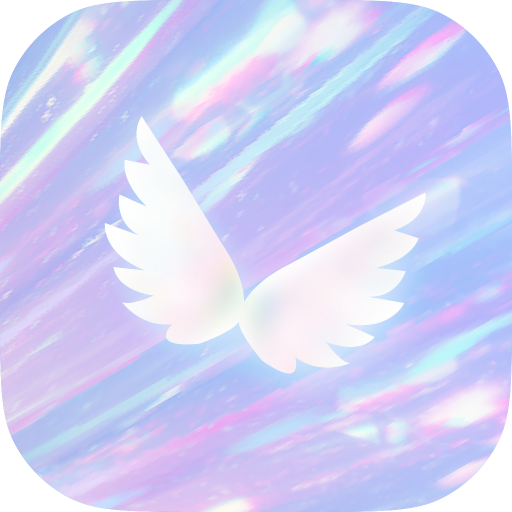

<p align="right">
  <a href="#english">English</a>
</p>

<br /><br />

<p align="center">
  
</p>

<h1 align="center">Reverie</h1>
<h3 align="center"><sub><em>千万次相逢的理由</em></sub></h3>

<p align="center">
  <strong>Landscape Game-Space Launcher for Android TV / Tablet / Handheld</strong>
</p>

<p align="center">
  <em>手柄全键位驱动 · 应用枚举与分类 · 最近游玩 · 使用统计 · 强制横屏 · Material You 动态主题</em>
</p>

<p align="center">
  <em>游戏详情页 · SteamDB 美术提取 · 玻璃拟态 · 拼音搜索 · 莫奈逐页取色</em>
</p>

<p align="center">
  <sub>v1.1.0 (3) · 2026-07-26 · Android 16 (API 36) · arm64-v8a · Kotlin + Jetpack Compose</sub>
</p>

<p align="center">
  <sub>© MocaBolka 2026 · co-created with CodeBuddy</sub>
  </p>
  <p align="center">
  <sub>包括本文档及程序在内均包含AI辅助生成。不代表本人立场。</sub>
</p>

---

<br />

<p align="center">
  <strong>Reverie 能做什么？</strong><br /><br />
  ▸ <strong>横屏游戏空间</strong>：左详情面板 + 右应用列表的大屏主屏，状态栏与收藏坞一应俱全<br />
  ▸ <strong>游戏详情页 GamePage</strong>：6 档断点响应式骨架、动态/统计/关于三 Tab、截图画廊、每日时间线、第三方 Widget 宿主、运行时逐页取色<br />
  ▸ <strong>SteamDB 美术提取</strong>：内置 WebView 探针从 SteamDB 抓取 Hero / Logo / 背景，9 点双对齐 Logo 定位系统，1:1 复刻 Steam 库视觉<br />
  ▸ <strong>全手柄操作</strong>：左摇杆/方向键导航，A 启动、B 返回、X 收藏、Y 搜索、LB/RB 切分类、LT/RT 翻页，子页统一手柄交互<br />
  ▸ <strong>应用管理</strong>：枚举已装应用、自动分类、收藏置顶、关键词 + <strong>拼音搜索</strong><br />
  ▸ <strong>最近游玩 & 使用统计</strong>：基于系统用量记录的"最近玩过"、时长 + 次数双维度日/周/月/年报表、原生 Material 日期选择器<br />
  ▸ <strong>视觉与主题</strong>：全站<strong>玻璃拟态</strong>、动态氛围背景、Material You 莫奈取色 + BrandColors 紫罗兰默认色板、深色/AMOLED 纯黑模式、逐页氛围取色<br />
  ▸ <strong>系统兼容</strong>：强制横屏锁、挖孔屏适配、瀑布屏安全边距、高刷新率、ColorOS 国产 ROM 兼容向导、通知角标<br />
  ▸ <strong>专注手柄的 UX</strong>：焦点框仅手柄连接时显、右摇杆物理积分滚动引擎、MD3 统一按钮库、全局表面令牌（SurfaceTokens）、列表/详情双态导航、归一化动画机（MotionMachines）<br />
  ▸ <strong>零外部依赖</strong>：纯 Jetpack Compose 实现，设置本地持久化，无需联网即可运行
</p>

<br />

---

## 📋 导航

- [30 秒了解](#30-秒了解)
- [核心能力](#核心能力)
- [手柄按键速查](#手柄按键速查)
- [技术栈](#技术栈)
- [环境要求](#环境要求)
- [项目结构](#项目结构)
- [构建](#构建)
- [权限说明](#权限说明)
- [常见问题 FAQ](#常见问题-faq)
- [版本历史](#版本历史)

---

## 30 秒了解

**Reverie** 是一个面向电视、平板与掌机的**横屏 Android 启动器**。它把设备上已安装的游戏和娱乐应用整理成一个干净的大屏界面，并且从导航、启动、搜索到设置，**全程用手柄即可完成，无需触摸**。

它不是系统默认桌面，而是作为一个普通应用独立运行——图标启动即进入游戏空间。首页采用**列表态 / 详情态双态导航**：左摇杆上下浏览应用列表，A 键进入详情面板，再按 A 启动，B 退回列表。任何旋屏设备均可通过内置**强制横屏锁**锁定横屏。

在 v1.1.0 中，Reverie 进化出完整的**游戏详情页（GamePage）**：聚焦某个游戏时，可进入沉浸式详情页，看到 Steam 风格的 Hero 大图与浮层 Logo、媒体截图画廊、每日游玩时间线，以及基于该游戏美术**运行时逐页取色**的氛围主题。美术资源来自内置的 **SteamDB 探针**——完全离线触发、本地落盘，不依赖任何外部服务。

---

## 核心能力

### 横屏游戏空间主屏

专为大屏宽屏设计的主界面：

- **宽屏左右分栏**（≥720dp）：左侧 300dp 详情面板（`AppDetailPanel`），右侧横排详细列表（`AppListItem`）
- **中等屏自适应**（<720dp）：主列表 + 底部 HUD 浮层（`AnimatedVisibility` + `slideInVertically`）
- **详情面板**：图标 / 名称 / 版本 / 启动时间 / 收藏 / 应用信息，日/周使用时长；支持焦点滚动（`FocusScroll.kt` 驱动，焦点出窗口自动滚入视野）
- **应用列表每行**：图标 + 名称 + 副标题 + 上次游玩 + 收藏按钮 + 通知角标
- **顶部 StatusBar**：时段问候语 + 四选一滑块 Tab（主页 / 统计 / 搜索 / 设置）+ 设置齿轮
- **底部收藏坞（Dock）**：常驻常用应用，一键启动
- **瀑布屏/曲面屏安全边距**：`Waterfall.kt` 自动读取 `displayCutout` 左右 inset 并取最大安全值，横屏时短路零开销

### 全手柄导航

自研手柄抽象层（`GamepadManager` → `GamepadEvent` + `XboxMapping`），物理按键归一为领域事件，UI 只消费事件。支持：

- 左摇杆 / 十字键帽导航，死区 0.40、回中 0.28、两段式长按加速（180ms→80ms）
- 右摇杆物理积分引擎（`RightStickScrollEngine.kt`）：真实帧间隔 `dt` 驱动、二段式 grow 加速（越滚越快，封顶 20000），60/120/144Hz 表现一致
- **列表态/详情态双态导航**：列表态 A 进详情、X 直接启动、Y 收藏、B 返回；详情态 A 触发当前按钮（默认启动）、B 退回列表；详情左右键在按钮间切焦点，上下 clamp 夹边界
- 所有 Dialog（下拉 / 信息 / 确认 / 日期选择）由桥接器统一分发键位事件
- 子页统一薄宿主 `SubPageGamepadHost.kt`（严禁子页自写摇杆解析），`SubPageKeyHandler.kt` 归一 `onKeyEvent`
- 搜索页默认进入列表态，Y 键仅切换输入框⇄列表、**绝不收藏**（与主页 Y=收藏分流）
- 统计页左右分栏独立：左排行（LB/RB 翻篇）、右总览（右摇杆滚动）
- 焦点恢复用 `hasFocus` + `onFocusChanged` 单一驱动，杜绝焦点框锁死

### 游戏详情页 GamePage（v1.1.0 全新）

聚焦单个游戏时的沉浸式详情页，由 `GamePageActivity` + `GamePage.kt` + `GamePageLayouts.kt` 构成：

- **响应式骨架**：`BoxWithConstraints` 约束推导 **6 档断点**（Compact/Medium Portrait、Compact/Medium/Expanded 1200–1600/ExtraLarge ≥1600 Landscape），分别套用 **PortraitBody / Landscape2Body / Landscape3Body** 三套骨架，横屏矮视口不再被全宽 Hero 吞掉垂直空间
- **扁平焦点状态机**：`GPSlots`（返回 / 应用信息 / 收藏 / 启动 / 动态 / 统计 / 关于 / 内容）驱动 `onKeyEvent`；↑↓ 栏内、←→ 跨栏（多列）、A 触发、B 返回、X 收藏、Y 在 TopBar⇄内容间跳、L1/R1 切游戏、L2/R2 切 Tab
- **三 Tab 体系**：动态 / 统计 / 关于（`GamePageTabs`，手柄连接时滑块两侧放 LB/RB 键位浮块）；公告功能已按用户决策移除，保持纯离线
- **动态 Tab**：媒体截图画廊（`ScreenshotGallery`，按文件名后缀哈希自动归类截图/录屏，SAF 授权 + 样例记忆）+ 每日游玩时间线 `TimelineRow`（按 UsageStats 聚合，MD3 ListItem）+ 时长趋势 `TrendSummary`
- **统计 Tab**：`TrendSummary`（总计 / 日均 / 最高 + 条形图）
- **关于 Tab**：版本 / 首次安装 / 权限（`PackageManager.GET_PERMISSIONS`）
- **第三方 Widget 宿主**：`GameWidgetHost.kt` 把社区 Widget 嵌入「个性化内容」区；米哈游/HoYoverse 系 → 米游社 + TapTap 合并选择器，其它 → 仅 TapTap
- **运行时逐页取色**：`GameArt.extractAccent` 离线手写 HSV 直方图，`accent` 优先级 游戏美术 > Monet > BrandColors；`GamePageColors.onAccent/tonal` 自动黑/白字，全站按钮 accent 单色系隔离
- **Hero 严格不裁切**：`ContentScale=FillHeight`（高度锚定，绝不上下裁切）；横屏矮视口 Hero 高度封顶
- **切游戏动画**：`AnimatedContent` 按最短循环距离定方向；`gameDataCache[pkg]` + `preloadNeighbors` 相邻 2 预载；未安装不进切换循环
- **预测返回统一**：`EdgeToEdge.kt` 的 `setupEdgeToEdgeImmersive()` 统一四个 Activity 沉浸状态栏，平台类型 `OnBackInvoked*`

### SteamDB 美术提取系统（v1.1.0 全新）

把 Steam 库级美术资源带入 Reverie，由 `ui/game/steamart/` 整包实现：

- **活动链路**：`SteamArtHubActivity`（入口：提取 / 自定义 / 重新提取 / 查看全部 / 清除）→ `SteamArtExtractActivity`（WebView 探针）→ `SteamArtCustomActivity`（自定义导入）→ `GameScreenshotsAllActivity`（查看全部截图）
- **三层架构**：`domain/`（提取任务 `ExtractAssetsUseCase` / `AssetSelector` / `ExtractionTiming`、模型 `AssetKind` / `SteamAsset` / `ExtractionState`）、`data/remote/`（`StoreApiClient` 商店兜底、`SteamCdnAssets` 静态图、`AssetDownloader`）、`data/webview/`（`CfWebViewClient` / `SearchWebViewClient` / `SteamWebViewFactory` / `SteamWebViewPolicy` / `ExtractionBridge`）、`ui/`（图组件 + `SteamArtViewModel`）
- **提取时序 4 阶段**：accent → library（胶囊/海报）→ logo（标志）→ background（背景）；`ExtractAssetsUseCase` 用 `channelFlow{send}`（严禁 `flow{emit}`，跨线程崩 Flow invariant）
- **WebView 探针与 Cloudflare**：`SteamWebViewPolicy` 白名单仅 `steamdb.info`；CF 检测分级；CF-free 兜底 `SteamCdnAssets` + 12s 回退；探针生命周期彻底 tear down，**只保留 cookie 过 CF，绝不 removeAllCookies**
- **稳定性 hardening**：删除全局 `WebStorage.deleteAllData()`（仅 flush Cookie）、成人门控防抖、弱网超时延长至 20s、`AtomicBoolean` 消除竞态、`shouldOverrideUrlLoading` 受白名单限制
- **缓存落盘**：下载至 `filesDir/steamart/<pkg>/`，JDK `HttpURLConnection`；`FileGameArtProvider` 优先 `AssetGameArtProvider`；`ArtSource.File` 带 `lastModified` 防串味

### Logo 定位系统（Steam 库规范合规）

`LogoPosition` 由 9 点枚举 + 真实百分比（`widthPct`/`heightPct`，范围 -100~200 含溢出）+ `anchor` 双对齐构成，支持 Steam 库级 Logo 浮于 Hero 任意位置（含跨边溢出）：

- **真实百分比体系**：`computeLogoBox` 以去 padding 的原图全尺寸（`严格 3.097:1`）为基准乘积，无 autoScale 压缩、无 dynamicScale 倍率，1:1 复刻 SteamDB 定位
- **自定义主题连续滑块**：`logoScale` 连续滑块（默认 1.0，每游戏独立）+ `logoCrop`（`cropTransparentEdges` alpha 包围盒裁剪），退出写 `meta.json`
- **预设 AppId 与 logo_position**：无限暖暖=3164330、绝区零=4162040、鸣潮=3513350；预设 `logo_position`（仅兜底，真实 SteamDB 值）均为 BottomLeft：无限暖暖=17.73611/42.36111、绝区零=37.18221/71.32872、鸣潮=22.66531/45.13934
- **落盘优先级**：WebView 探针 > 商店 API > 已导入定位 > 预设兜底；任何真实导入/提取都覆盖预设

### 玻璃拟态全站改造（Glassmorphism）

- `ui/theme/GlassState.kt`：主活动入口默认全开 `LocalGlassEnabled`（含 `onResume` 重写取色驱动），各子页默认关（避免性能/视觉冲突），由 `HomeViewModel` 单源驱动
- `frosted` 用 `RenderEffect` / `Motion.blur` 实现毛玻璃；`WallpaperBackground` 改用模糊壁纸做毛玻璃底
- `SurfaceTokens` 玻璃表面用 `glassBg = background.copy(0.72f) + blur`，`AppDetailPanel` 玻璃化（横屏右栏 + 竖屏浮层共用）

### 焦点框智能显示

`FocusIndicators.kt` 通过 `LocalShowFocusIndicators` 全局开关控制焦点框渲染，手柄连接时显示导航焦点框，纯触控/手柄未连接时自动隐藏。全场景（AppListItem / AppDetailPanel / SubPage / StatsScreen / LaunchCircleButton / Buttons）统一由 `Modifier.focusBorder()` 守卫，无死区。

### 应用枚举与分类

通过 `PackageManager.queryIntentActivities(MATCH_ALL)` 枚举已装应用（无须默认桌面身份），可选包含系统应用。按类别分组（游戏 / 影视 / 音乐 / 社交 / 工具等 9 类），支持逐应用分类覆盖。图标经磁盘缓存（`IconCache`，`filesDir/icons/{pkg}.png`）；`LauncherApps.Callback` 增量监听包变化。

### 收藏与最近游玩

- **收藏坞（Dock）**：底部常驻，一键启动，支持清空收藏（二次确认）
- **最近游玩**：基于 `UsageStatsManager` 近似还原"最近玩过"（需用量访问权限）；`queryLastUsed` 取真实最近一次（修复"8 天前"陈旧）

### 搜索（拼音搜索）

- 手柄驱动的关键词搜索，实时高亮匹配，相关性排序（前缀 > 标签 > 包名 > 分类）
- **拼音搜索**（`util/Pinyin.kt`）：按拼音/首字母匹配应用名，与 `label` 过滤合并
- 结果计数标签、Enter 直接启动首项；搜索态 Y 键默认列表态、仅切输入框⇄列表

### 使用统计

完整统计页（`StatsScreen`）：

- 日 / 周 / 月 / 年四档报表，`ReverieSegmentedRow` 分段控件切换
- **时长 + 次数双维度**（次数维度为 v1.1.0 新增）
- 系统/自身包聚合避免污染排行；逐日列表倒序（`getDailyUsageList`/`getMonthlyUsageList`），零值「—」
- **原生 Material3 DatePicker / DateRangePicker**（日/月/年视图），周视图由选日按周首落周
- **快速按钮锚点**：最近游玩→排行区、总计时长→列表区（页内锚点滚动，不跳设置页）
- 增量写入 `usage_stats.json`（原子写，查询 O(1)）

### 全局表面令牌（SurfaceTokens）

`SurfaceTokens.kt` 终结散落 alpha 魔法值：统一焦点背景（0.20）、按压背景、卡片表面层级、scrim 遮罩（引用 `MotionSpec.ScrimAlpha`）、静音文字、玻璃底色、分段容器色等。配套 `SurfaceCard` / `ReverieToast` / `AccentIconSquare` 等可复用组件。改一处全站生效。

### MD3 统一按钮库（Buttons.kt）

5 类 MD3 标准按钮 + 自绘 `ReverieSegmentedRow<T>` 分段控件：

| 按钮 | 说明 |
|------|------|
| `ReverieFilledButton` | 实心主按钮 |
| `ReverieTonalButton` | 色调按钮 |
| `ReverieOutlinedButton` | 描边按钮 |
| `ReverieTextButton` | 文字按钮 |
| `ReverieIconButton` | 图标按钮 |
| `ReverieSegmentedRow<T>` | 分段切换控件（官方 `SegmentedButton` 在 material3 1.3.2 不可用，自绘等价实现） |

所有按钮设 `danger=true` 时使用 error 色，统一 40dp 高、`shapes.medium` 圆角、`wrapFocusBorder` 焦点边框。

### 动画机 MotionMachines（v1.1.0 新增）

`ui/theme/MotionMachines.kt` 统一 `crossfade` / `backgroundCrossfade` 等可复用动画机器，**严禁页面散落一次性动画**（铁律：已存在则引用，不存在则先沉淀再引用）。`GamePage` 切游戏背景复用 `backgroundCrossfade`。

### 组件与令牌归一化（v1.1.0 新增）

- `BottomFadeMask.kt`（底部渐隐遮罩）、`LayoutModifiers.kt`（`statusBarSafeTop` 安全区）、`ScrollProgressBar.kt`（滚动进度条）
- `CenteredHint` 统一居中提示；`DialogScaffold` 全站 dialog 模板（scrim + 居中卡片 + 底部 HintBar）
- `SubPageKeyHandler.kt` 归一子页 `onKeyEvent`（按键判定 `action != ACTION_DOWN`；Activity 自管 `onGenericMotionEvent`）

### 视觉与主题

| 能力 | 说明 |
|------|------|
| BrandColors 默认色板 | 紫罗兰深蓝**自定义色板**（非 MD3 默认蓝），补全 M3 全部色键 |
| Material You 莫奈 | 从系统壁纸提取色板，深色模式将基础色与强调色分开处理——强调色保留莫奈，背景退回项目自带深色 |
| 逐页氛围取色 | `GamePage` 基于游戏美术运行时取色，accent 单源 `GameArt.extractAccent`，本页不随 Monet 覆盖 |
| AMOLED 纯黑 | 背景 `Color.Black`，强调色保留莫奈，开关无重启 |
| 动态氛围背景 | 缓慢漂移的柔光渐变（可关，省电/晕动友好） |
| 玻璃拟态 | 详情面板/状态栏磨砂模糊、光晕描边（可关） |
| 壁纸穿透 | 可选显示系统桌面壁纸作背景 |
| 减少动效 | 冻结无限循环动画，`Motion.kt` 全链路守卫 |

### 系统兼容与优化

- **强制横屏锁**：`systemExempted` 前台服务（`OrientationLockService`）挂载透明 `TYPE_APPLICATION_OVERLAY` 约束系统方向，8 种方向模式可选
- **挖孔屏适配**：横屏内容延伸至摄像头区域（`windowInsetsPadding(displayCutout)`），OPPO/华为 ROM 短边特殊处理
- **瀑布屏安全边距**：`Modifier.waterfallSafePadding()` 自动适配曲面屏，横屏短路零开销
- **高刷新率**：resume 拉满峰值帧率，idle/pause 回落平衡率省电
- **触感反馈**：手柄振动反馈焦点与确认（`Haptics` 单源，杜绝双震）
- **ColorOS 兼容向导**：首次启动 5 项 OEM 权限引导（电池优化 / 自启动 / 悬浮窗 / 用量访问 / 通知监听），深链跳转 + 安全兜底
- **通知角标**：可选 `NotificationListenerService`（默认关，需系统设置开启）
- **启动后不保留进程**（v1.1.0 新增开关，默认关）：开启后启动游戏即 `finishAndRemoveTask()`

### 子页面与开屏

- **Splash 沉浸化**：自适应 Adaptive Icon（`ic_launcher.xml`，三层前景/背景/单色）+ `brandtext.png` 品牌图 + `Theme.SplashScreen` 亮暗双主题 + 无标题栏/全屏。原生 Splash 仅对齐深色背景，第二幕 `SplashOverlay` 由 `HomeScreen` 数据就绪后驱动
- **SubPageScaffold**：统一全屏子页面框架（`AnimatedVisibility` 左右进出动画）、底部固定按钮（`bottomAction`）、右摇杆焦点跟随（`suppressAutoScroll` 防反向抖动）、`showFocusIndicators`、瀑布屏安全边距；所有 2/3 级子页统一 `KeyBadge.SubPageTitleBar`（40dp 返回钮）
- **About / Licenses 页**：子页面独立 `MaterialTheme`（深色/莫奈跟随）、双路 `AnimatedVisibility` 实现 About↔Licenses 连贯转场、完整手柄导航、开源许可入口

---

## 手柄按键速查

### 主屏 / 列表

| 按键 | 作用 |
|------|------|
| 左摇杆 / 方向键 | 导航列表与面板 |
| **A** | 列表态→进详情 / 详情态→触发按钮 / 输入态→启动首项 |
| **B** | 返回 / 退出 / 输入态→退输入 |
| **X** | 列表态→直接启动聚焦应用 |
| **Y** | 列表态→收藏 / 搜索态→切输入框⇄列表（绝不收藏） |
| **LB / RB** | 切换分类 Tab / 统计页翻月翻年 |
| **LT / RT** | 切换主页面（主页 / 统计 / 搜索 / 设置） |
| 右摇杆 | 物理积分滚动（越滚越快） |
| 左摇杆按压 | 详情态退回列表 / 统计页弹出日期选择 |
| **Menu** | 打开设置 |

### 游戏详情页 GamePage

| 按键 | 作用 |
|------|------|
| ↑ / ↓ | 栏内移动焦点 |
| ← / → | 跨栏（多列）/ 切 Tab（L2/R2 时） |
| **A** | 触发当前焦点（启动 / 打开截图） |
| **B** | 返回主屏（画廊聚焦时→退出画廊） |
| **X** | 收藏 / 取消收藏 |
| **Y** | TopBar ⇄ 内容 之间跳转 |
| **L1 / R1** | 切上一个 / 下一个游戏 |
| **L2 / R2** | 切 Tab（动态 / 统计 / 关于） |
| 右摇杆 | 内容区滚动（画廊逐张跟随） |

---

## 技术栈

| 层 | 技术 | 角色 |
|----|------|------|
| 语言 | Kotlin 2.x（JVM 17） | 应用逻辑 |
| UI | Jetpack Compose（BOM 2025.06.00，Material 3 1.3.2） | 声明式界面、主题、动画 |
| 架构 | MVVM（ViewModel + StateFlow） | UI 状态与业务逻辑 |
| 输入 | 自研手柄层（GamepadEvent / GamepadManager / XboxMapping / GamepadDetector / RightStickScrollEngine / SubPageGamepadHost） | 全控制器抽象为领域事件 |
| 游戏详情 | GamePage 家族（Activity / 布局 / 取色 / Widget 宿主）+ SteamDB 探针（WebView / Store API 兜底） | 沉浸式详情页与美术提取 |
| 应用数据 | `PackageManager`（`queryIntentActivities`）+ `LauncherApps.Callback` | 枚举应用、增量监听 |
| 最近/统计 | `UsageStatsManager` | 最近应用与使用时长 |
| 持久化 | `SharedPreferences` + JSON 文件 | 设置项、用量统计、Logo 定位（meta.json） |
| 兼容 | NotificationListenerService、前台服务 | 角标、强制横屏锁 |
| 构建 | Android Gradle Plugin 8.x + Kotlin Gradle Plugin | 构建与 R8 压缩（release） |
| 图标 | Adaptive Icon（`ic_launcher.xml`）+ VectorDrawable（`ic_app_logo`） | 原生 Splash、应用内图标 |

---

## 环境要求

- **Android 16（API 36）** 设备——手机、平板、电视或掌机，横屏使用
- Android SDK **`android-36.1`**（需 FRAME_RATE_CATEGORY / RampSegment 等 API 36 符号）
- Gradle（已内置 wrapper），首次构建需联网拉取依赖
- `QUERY_ALL_PACKAGES` 已声明；非默认桌面场景建议在系统设置授予"应用列表访问"
- 最近游玩与使用统计需 `PACKAGE_USAGE_STATS` 权限（设置 → 特殊权限 → 用量访问）
- 竖屏设备强制横屏需授予**显示在其他应用上层（悬浮窗）**权限
- SteamDB 美术提取为本地 WebView 探针，需联网访问 `steamdb.info`；仅提取时联网，日常运行无需联网

---

## 项目结构

```
Reverie/
├── app/
│   ├── build.gradle.kts        # namespace cn.mocabolka.run, minSdk/targetSdk 36, versionCode 3
│   ├── proguard-rules.pro      # Release 的 R8 规则
│   └── src/main/
│       ├── AndroidManifest.xml # 权限、Activity、Service（OrientationLock、NotificationBadge）
│       ├── java/cn/mocabolka/run/
│       │   ├── LauncherApplication.kt   # Application 子类，全局崩溃兜底
│       │   ├── MainActivity.kt          # Compose 宿主、输入分发、生命周期、刷新率、Splash 安装
│       │   ├── gamepad/                 # 手柄抽象层
│       │   │   ├── GamepadEvent.kt      # 领域事件与枚举模型
│       │   │   ├── GamepadManager.kt    # 按键/摇杆 → 事件，死区、重复、滚动
│       │   │   ├── GamepadDetector.kt   # 连接检测（InputDevice 广播）
│       │   │   ├── RightStickScrollEngine.kt # 右摇杆物理积分滚动引擎
│       │   │   ├── SubPageGamepadHost.kt # 子页统一薄宿主（右摇杆物理滚动 + 焦点回写）
│       │   │   └── XboxMapping.kt       # 按键 → 事件映射（Xbox/标准 HID）
│       │   ├── launcher/                # 数据与领域层
│       │   │   ├── AppModel.kt          # 应用数据模型与分类映射
│       │   │   ├── AppRepository.kt     # 枚举应用、IconCache
│       │   │   ├── RecentsRepository.kt # 最近应用（UsageStats）
│       │   │   ├── UsageStatsRepository.kt # 用量聚合与持久化（usage_stats.json）
│       │   │   ├── FavoritesRepository.kt   # 收藏
│       │   │   ├── CategoryMapping.kt / CategoryOverrideRepository.kt
│       │   │   └── AppLauncher.kt / AppCache.kt / IconCache.kt / GameWhitelist.kt
│       │   ├── compat/                  # 厂商与系统兼容
│       │   │   ├── ColorOSCompat.kt     # 深链跳转 ColorOS 设置
│       │   │   ├── CompatGuideActivity.kt # 首次启动兼容向导 + SubPageScaffold
│       │   │   ├── OrientationLockService.kt / OrientationManager.kt # 强制横屏锁
│       │   │   ├── NotificationBadgeService.kt # 通知监听（角标）
│       │   │   └── *PermissionHelper.kt # 电池 / 悬浮窗 / 用量访问 助手
│       │   ├── viewmodel/
│       │   │   └── HomeViewModel.kt     # 核心 ViewModel（事件、状态、加载、统计、玻璃态）
│       │   ├── util/
│       │   │   └── Pinyin.kt            # 拼音搜索（v1.1.0）
│       │   └── ui/
│       │       ├── HomeScreen.kt        # 主屏组合、焦点分发、右摇杆引擎、列表/详情双态
│       │       ├── SettingsRepository.kt# 全部设置（StateFlow + SharedPreferences）
│       │       ├── OrientationMode.kt   # 方向模式枚举
│       │       ├── DisplayRefresh.kt    # 刷新率管理
│       │       ├── EdgeToEdge.kt        # 预测返回 + 沉浸状态栏（v1.1.0）
│       │       ├── Haptics.kt           # 触感反馈（单源）
│       │       ├── theme/
│       │       │   ├── Theme.kt         # 主题入口 + BrandColors 紫罗兰色板
│       │       │   ├── MonetTheme.kt    # Material You 莫奈取色
│       │       │   ├── Motion.kt        # 统一动画引擎：MotionSpec、rememberPulse、PulseSpec
│       │       │   ├── MotionMachines.kt# 动画机归一（crossfade 等，v1.1.0）
│       │       │   ├── Dimens.kt        # 全局间距体系
│       │       │   ├── FocusIndicators.kt # 焦点框全局开关 + focusBorder modifier
│       │       │   ├── SurfaceTokens.kt # 表面令牌层：alpha、卡片、遮罩、玻璃
│       │       │   ├── Buttons.kt       # MD3 统一按钮库（5 类 + SegmentedRow）
│       │       │   ├── GlassState.kt    # 玻璃拟态全局开关（v1.1.0）
│       │       │   └── Waterfall.kt     # 瀑布屏安全边距处理器
│       │       ├── components/          # AppDetailPanel / AppListItem / Dock / StatusBar /
│       │       │                       # RecentsRow / SettingsPage / StatsScreen /
│       │       │                       # SplashAnimation / AmbientBackground / RevealOverlay /
│       │       │                       # FocusScroll / DialogScaffold / KeyBadge /
│       │       │                       # BottomFadeMask / LayoutModifiers / ScrollProgressBar /
│       │       │                       # SubPageKeyHandler / AboutPage / LicensesPage（v1.1.0 新增多项）
│       │       ├── AboutActivity.kt / LicensesActivity.kt
│       │       └── game/                # 游戏详情页 + SteamDB 美术提取（v1.1.0 全新）
│       │           ├── GamePageActivity.kt / GamePage.kt / GamePageLayouts.kt
│       │           ├── GamePageColors.kt / GameArt.kt / GameArtBackground.kt
│       │           ├── GameWidgetHost.kt / GameLaunchOverlay.kt
│       │           ├── GameScreenshots.kt / GameScreenshotsAllActivity.kt
│       │           └── steamart/        # SteamDB 提取链路
│       │               ├── domain/      # ExtractAssetsUseCase / AssetSelector /
│       │               │               # ExtractionTiming / SteamLanguage / 模型
│       │               ├── data/
│       │               │   ├── remote/  # StoreApiClient / SteamCdnAssets / AssetDownloader
│       │               │   └── webview/ # CfWebViewClient / SearchWebViewClient /
│       │               │               # SteamWebViewFactory / SteamWebViewPolicy /
│       │               │               # ExtractionBridge / SteamSearchWebView
│       │               └── ui/          # SteamArtHub/Extract/Custom Activity、
│       │                               # SteamArtGraph / SteamArtViewModel / Contracts
│       └── res/
│           ├── drawable/                 # ic_app_logo.webp, brandtext.png
│           ├── mipmap-anydpi-v26/        # ic_launcher.xml (Adaptive Icon, 3-layer)
│           ├── mipmap-*/                 # launcher icon raster fallback
│           ├── values/themes.xml         # Theme.Launcher.Starting / Launcher / Landscape
│           └── values/strings.xml        # 应用名称、兼容向导、横屏锁文案
├── gradle/                       # Wrapper
├── build.gradle.kts              # 根构建配置
├── settings.gradle.kts
├── gradle.properties
├── gradlew / gradlew.bat
└── icon.png                      # 应用图标
```

---

## 构建

```powershell
# Debug（依赖已缓存时可离线）
.\gradlew.bat assembleDebug

# Release（R8 压缩 + 资源缩减）
.\gradlew.bat assembleRelease
```

产物 APK：`app/build/outputs/apk/debug/app-debug.apk`（或 `release/`）。

> **注意**：`minSdk` / `targetSdk` 固定为 API 36（Android 16）。项目依赖 `android-36.1` 帧率分类符号与 `core-splashscreen:1.0.1`，假设设备为 64 位 ARM（`arm64-v8a`），不产出 x86 / 32 位构建。Release 通过 R8 + ProGuard 缩减，APK 约 30-41MB。离线编译遇 `Could not reserve enough space in CodeHeap` 时先清 `_JAVA_OPTIONS=''`。

---

## 权限说明

| 权限 | 用途 |
|------|------|
| `QUERY_ALL_PACKAGES` | 枚举已装应用，构建游戏空间列表 |
| `PACKAGE_USAGE_STATS` | 最近游玩与使用统计 |
| `REQUEST_IGNORE_BATTERY_OPTIMIZATIONS` | 后台保活 |
| `VIBRATE` | 手柄触感反馈 |
| `FOREGROUND_SERVICE` / `FOREGROUND_SERVICE_SYSTEM_EXEMPTED` | 强制横屏锁服务 |
| `SYSTEM_ALERT_WINDOW` | 竖屏设备横屏锁悬浮窗 |
| `BIND_NOTIFICATION_LISTENER_SERVICE` | 通知角标（可选） |
| 网络（`INTERNET`） | 仅 SteamDB 美术提取时联网访问 `steamdb.info`，日常运行不联网 |

---

## 常见问题 FAQ

### Q：Reverie 是默认桌面吗？
A：不是。它作为普通应用独立运行，打开即进入游戏空间，可随时切回系统桌面。

### Q：没有手柄能用吗？
A：可以。界面同时支持触摸与鼠标交互；手柄只是提供了"全程免触摸"的完整体验。无手柄连接时焦点框自动隐藏，界面更干净。

### Q：游戏详情页里的美术图从哪来？
A：来自内置的 **SteamDB 探针**——在游戏详情页点「主题 → 提取」，App 会本地启动 WebView 抓取 `steamdb.info` 的 Hero / Logo / 背景，下载落盘到 `filesDir/steamart/<pkg>/`。全程本地触发，仅提取时联网；也支持「自定义」手动导入。

### Q：为什么列表里应用很少？
A：若未授予"应用列表访问"（`QUERY_ALL_PACKAGES` 受限），枚举可能为空。UI 会显示可聚焦的「前往授权」入口，授予后重新扫描即可。

### Q：最近游玩不准？
A：数据为基于系统用量统计的近似结果，需授予 `PACKAGE_USAGE_STATS` 权限；部分厂商 ROM 用量记录本身不完整。

### Q：强制横屏在竖屏手机上不生效？
A：需在系统设置授予「显示在其他应用上层（悬浮窗）」权限，否则服务会提示并跳转到权限页。

### Q：Material You 取色看着怪？
A：莫奈深色 `background/surface` 是壁纸调深色版（浅紫/浅蓝等），不符合规范。Reverie 已将基础色退回紫罗兰深蓝而强调色保留莫奈——若仍不满意，可在设置页关闭莫奈取色回退 BrandColors。游戏详情页还会基于该游戏美术逐页取色，独立于系统莫奈。

### Q：开源吗？
A：当前以专有（Proprietary）协议发布，仅供学习与个人使用。

---

## 版本历史

当前版本：**v1.1.0 (3) — 2026-07-26**。

完整变更记录参见 `changelog.md`。主要更新摘要：

**v1.1.0（重大功能版本）**
- **游戏详情页 GamePage**：6 档断点响应式骨架、扁平焦点状态机、动态/统计/关于三 Tab、截图画廊、每日时间线、第三方 Widget 宿主、运行时逐页取色、Hero 严格不裁切、切游戏动画
- **SteamDB 美术提取**：`ui/game/steamart/` 整包，WebView 探针 + 商店兜底、Cloudflare 分级、4 阶段提取时序、本地落盘防串味
- **Logo 定位系统**：9 点双对齐 + 真实百分比（3.097:1 基准），1:1 复刻 Steam 库视觉
- **玻璃拟态全站改造**：`GlassState.kt` + `SurfaceTokens.glass`，主活动默认全开
- **动画机 MotionMachines**：可复用动画机器，严禁页面散落一次性动画
- **手柄交互归一化**：`SubPageGamepadHost` / `SubPageKeyHandler` / `Haptics` 单源 / 焦点恢复单驱动 / 子页标题栏归一
- **组件与令牌归一化**：`BottomFadeMask` / `LayoutModifiers` / `ScrollProgressBar` / `DialogScaffold`
- **统计页增强**：时长 + 次数双维度、系统包聚合、逐日倒序、快速按钮锚点
- **拼音搜索**：`Pinyin.kt` 按拼音/首字母匹配
- **稳定性**：竖屏点按不弹抽屉、设置页 LT/RT、进入其它应用不重置、启动后不保留进程开关、"8 天前"陈旧根治、SteamDB 门控竞态漏抓修复、提取下载并行化

**v1.0.0（2）**
- 由系统桌面转向纯「游戏空间」；列表态/详情态双态导航；右摇杆物理积分引擎；焦点框仅手柄连接时可见；MD3 按钮库；SurfaceTokens；原生 DatePicker；Adaptive Icon + Splash 收口；API 36 全量合规

---

## English

**Reverie** is a landscape-oriented Android launcher for TVs/tablets/handhelds. It organizes games and entertainment apps into a clean big-screen layout with full gamepad control.

**Latest build: v1.1.0 (3) — 2026-07-26**

Key capabilities include: dual-state (list/detail) landscape home with adaptive 21:9 layout; complete gamepad abstraction with physical right-stick scroll engine; app enumeration without default-launcher identity; UsageStats-based recents & statistics (duration **and** launch-count dimensions) with native Material3 DatePicker; Material You (Monet) dynamic theming with BrandColors violet fallback; forced-landscape lock service; ambient background & glassmorphism; intelligent focus-indicator visibility; MD3 button library; SurfaceTokens global token layer; MotionMachines animation engine; waterfall/curved-screen safe padding; ColorOS compatibility wizard; notification badges; adaptive-icon + brand-image splash.

**v1.1.0 major additions**: full **GamePage** detail experience (6 responsive breakpoints, flat focus state machine, Dynamic/Stats/About tabs, screenshot gallery, daily timeline, third-party Widget host, runtime per-game accent extraction), a self-contained **SteamDB art-extraction** pipeline (`ui/game/steamart/`: WebView probe + store fallback + Cloudflare handling + 4-stage timing + on-device caching), a **9-point Logo positioning** system (true 3.097:1 Steam-compliant placement), **pinyin search**, and a wave of stability fixes (gamepad normalization, entry-not-resetting-on-resume, "8 days ago" stale recents fix, SteamDB gating race fix, parallel download).

Tech: Kotlin + Jetpack Compose (BOM 2025.06.00, Material3 1.3.2), MVVM, `minSdk`/`targetSdk` = API 36, `arm64-v8a`. Build with `.\gradlew.bat assembleDebug`.

---

<p align="center">
  <sub>专有协议 · 保留所有权利 · 本文档及代码包含 AI 辅助生成，仅供参考</sub>
</p>
